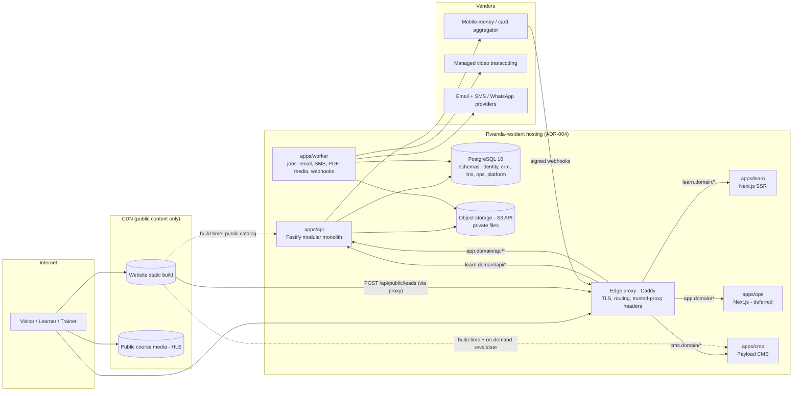

# 02 — Target Architecture

**Status:** Proposed. Each decision marked **ADR-P#** is written up as a proposed ADR in [07-MIGRATION-PLAN.md](07-MIGRATION-PLAN.md#5-proposed-adrs). None of them is binding until the Managing Director accepts it.

Domain names are written as `{domain}`, because the production domain is still undecided (`docs/marketing/SEO_STRATEGY.md`).

---

## 1. Principles

Carried forward from v1, because they still hold:
- **Sourced, not invented.** No fabricated metrics, testimonials or capabilities.
- **Proportionate.** Every component has to justify itself against a small team and a small budget.
- **Rwanda by default** for personal data (Data Privacy Policy §6, ADR-004).
- **Modular monolith** for the backend (ADR-001 still holds; see §4).

New for v2:
- **Products, not pages.** The website and the e-learning platform are separate products. Each has its own users, release cadence, SLOs and blast radius.
- **The website must stay up when everything else is down.** It is static-first and has no runtime dependency on the API for page rendering.
- **Same-origin by construction.** Browsers only ever talk to the origin they loaded. No CORS, no cross-site cookies, no API URL baked into bundles (fixes N-2).
- **One image, every environment.** All environment-specific values are read at runtime. Images are promoted unchanged from staging to production.
- **Buy commodity, build differentiation.** Payments, video transcoding, email and SMS delivery are bought. The learning experience, its integration with Advisory, and low-bandwidth delivery are built.

## 2. Product boundaries

| Product | Host | Users | Purpose | Auth |
|---|---|---|---|---|
| **Website** | `www.{domain}` | Public, prospects | Brand, four divisions, course marketing pages, lead capture, privacy policy. **Routes learners to the LMS.** | None |
| **E-Learning (Z-GATE Academy Online)** | `learn.{domain}` | Learners, trainers, Academy admins, corporate client admins | Catalog, enrollment and payment, lessons, quizzes, live cohorts, certificates | Yes |
| **CMS** | `cms.{domain}` (IP-restricted) | Marketing staff | Edit website content without a developer | Yes (staff) |
| **Operations portal** *(deferred, decision D2)* | `app.{domain}` | Advisory clients, internal staff | The existing client portal and staff console (CRM, compliance, deliverables, reporting) | Yes |
| **Platform API** | Internal only; exposed as `/api/*` under each product's host | — | One modular-monolith backend serving every product | Sessions per product host |

The website has **no login**. Its header "Log in" and "Start learning" buttons are links to `learn.{domain}`. This is the separation the business asked for: the website directs people to the e-learning platform instead of containing the business's whole infrastructure.

## 3. Topology

Key properties:
- **The website is a static build on a CDN.** Its only runtime calls are the lead form and the newsletter form. They go through the edge proxy at `www.{domain}/api/public/*`, so they are same-origin too.
- **Path-based routing happens at the edge proxy, not in Next.js.** `learn.{domain}/api/*` goes to the API, everything else goes to the learn app. Proxy configuration is runtime configuration, so N-2 cannot recur.
- **The API trusts exactly one proxy hop** (`trustProxy` set to the proxy's address), which fixes N-1.
- **The worker is the same codebase as the API** with a different entry point (`node dist/worker.js`). Slow or unreliable work (email, SMS, PDFs, video ingestion, payment reconciliation) leaves the request path.
- **Vertical first.** All of the Rwanda box runs on 1–2 VMs with Docker Compose at launch. §8 covers the scale-out path.

## 4. Backend: one deployable, bounded contexts, Postgres schemas

ADR-001 (modular monolith) **still holds**: the team is small and traffic is modest. v2 makes the boundaries **enforced rather than conventional**:

| Context | Postgres schema | Owns | Used by |
|---|---|---|---|
| `identity` | `identity` | Users, credentials, sessions, roles and memberships, MFA factors, consents | All |
| `crm` | `crm` | Leads, lead sources/attribution, conversions | Website, ops |
| `lms.catalog` | `lms` | Courses, versions, modules, lessons, cohorts, pricing | Learn, website (read-only public catalog) |
| `lms.learning` | `lms` | Enrollments, progress, attendance | Learn |
| `lms.assessment` | `lms` | Quizzes, question banks, attempts, assignments, grading | Learn |
| `lms.credentials` | `lms` | Certificates, verification codes, revocation | Learn, public verify page |
| `commerce` | `commerce` | Orders, payments, refunds, seat licences (B2B), invoices-as-records | Learn |
| `ops` | `ops` | Clients, engagements, compliance items, deliverables (moved unchanged from v1) | Ops portal |
| `platform` | `platform` | Audit events, outbox, job queue, notification log, media assets | All |

Rules:
1. **Each context's DB role can only read and write its own schema.** Cross-context reads go through exported service functions, or through read-only views that the owning context publishes explicitly. Postgres grants enforce this; it is no longer only a code review convention. This is the extraction seam ADR-001 described, made real.
2. **Cross-context side effects go through the transactional outbox** (`platform.outbox`). Example: when `commerce` marks a payment `succeeded`, it writes `payment.succeeded` in the same transaction. The worker then delivers it to `lms.learning`, which activates the enrollment. This gives retries, idempotency and an audit trail, without a message broker.
3. **Each context is a Fastify plugin** with its own routes, schemas, services and repositories. Authorization is declared as route metadata (`config: { auth: { roles: [...], scope: "cohort" } }`) and enforced by one `preHandler`. **A route with no auth declaration fails at startup** (fixes §6.6 of the assessment).
4. **Contracts are shared.** Zod schemas live in `packages/contracts`. The API uses them through `fastify-type-provider-zod`, which also generates **OpenAPI 3.1** at `/api/v1/openapi.json`. Frontends import the same schemas. Hand-mirrored copies are no longer needed.
5. **Versioned API.** Everything moves under `/api/v1`. Public, cacheable endpoints live under `/api/v1/public/*` with `Cache-Control` headers.

## 5. Identity, sessions and access control

**Recommendation: keep authentication in-house (ADR-005's cost and residency reasoning still applies) but rebuild the session and role model (ADR-P3).**

| Concern | v1 | v2 |
|---|---|---|
| Session storage | Encrypted cookie containing role and clientId; cannot be revoked (N-3) | **Server-side session table.** The cookie holds only a 256-bit random ID, named `__Host-zg_sid` (host-only, `Secure`, `HttpOnly`, `SameSite=Lax`). Sliding 7-day expiry for learners; 12-hour absolute expiry for staff. |
| Revocation | Only by rotating the global secret | Per session, per user ("sign out everywhere"), and automatically on password change, deactivation or role change |
| Password hashing | bcrypt cost 12 | **Argon2id** (`@node-rs/argon2`). Existing bcrypt hashes are rehashed transparently at the next login. |
| Login methods | Email and password | Email and password; **phone number plus SMS OTP** (for users who don't use email); **Google sign-in** (optional, for learners) |
| MFA | None | **Mandatory for staff, trainers and admins** (TOTP, then passkeys/WebAuthn). Optional for learners. |
| Sign-up | None (CR-8) | Learner self-sign-up with email or phone verification. Staff and client accounts by **invitation only** (fixes CR-8 for the ops portal). |
| Roles | Postgres enum on `users.role`; one role per user | `identity.memberships(user_id, role, scope_type, scope_id)`. For example, `learner` (global), `trainer` (scope `cohort:…`), `org_admin` (scope `organization:…`), `academy_admin`, `advisory_staff` (scope `engagement:…`, which fixes F-4). Roles are rows, not enum values, so adding one needs no migration. |
| Per-request check | Trusts the cookie | Loads the session, user and memberships on each request (one indexed query, cached in-process for about 30 seconds). Deactivated users are rejected immediately. |
| CSRF | SameSite=Lax | SameSite=Lax **plus** an `Origin`/`Sec-Fetch-Site` check on every state-changing request |
| SSO across products | N/A | Not needed at launch: learn and ops have separate host-only sessions, which keeps their blast radii apart. **Trigger to adopt a self-hosted OIDC IdP (Keycloak or Zitadel):** a third logged-in product, a partner login, or enterprise SSO for a corporate client. The identity module stores OIDC-compatible claims from day one so that move is a migration, not a rewrite. |

## 6. How the website hands off to the LMS

This is the integration contract between the two products. It is deliberately small.

| Concern | Contract |
|---|---|
| **Course pages** | The website renders `/academy/courses/{slug}` from `GET /api/v1/public/catalog` (published courses, upcoming cohorts, price, outcomes) **at build time**. When a course is published or changed, the LMS emits `course.published`, and the worker calls the website's on-demand revalidation webhook. Marketing pages stay static and indexable but are never stale for long. |
| **Calls to action** | "Enroll" goes to `https://learn.{domain}/courses/{slug}/enroll?cohort={id}&utm_source=…&utm_medium=…&utm_campaign=…`. The LMS stores UTM parameters and the referrer on the enrollment (`lms.enrollments.attribution`), so the business can see which channel actually produced paying learners. |
| **Global navigation** | Website header: Divisions · Academy · About · Contact · **Log in** (to `learn.{domain}/login`) · **Start learning** (to `learn.{domain}/courses`). LMS header: logo links back to `www.{domain}`. Both come from `packages/ui`, so the hand-off looks like one brand. |
| **SEO ownership** | **The website owns indexable course marketing pages** (with `Course` and `EducationalOccupationalCredential` JSON-LD). LMS public course pages set `<link rel="canonical">` to the website page. Everything behind login is `noindex`. Certificate verification pages are `noindex` but shareable. |
| **Leads** | The website contact form calls `POST /api/v1/public/leads` (CRM). A website enquiry about a course becomes a lead with `interest = academy`. |
| **Cross-sell (Academy to Advisory)** | During LMS onboarding, learners are asked "Do you run or manage a business?" with **explicit, separate consent** to be contacted by Advisory. If they consent, the system emits `learner.business_interest`, which creates a CRM lead. This puts the "one gate, four rooms" strategy (`docs/business/CROSS_DIVISION_WORKFLOWS.md`) into the product, with consent. |
| **Analytics** | One privacy-respecting, self-hostable analytics tool (Umami or Plausible CE) on both hosts. Funnel events: `course_view → enroll_start → payment_success → first_lesson_complete → certificate_issued → certificate_shared`. No third-party ad trackers on `learn.{domain}`. |
| **Failure isolation** | If the API is down, the website still serves every page; only the forms degrade, showing a WhatsApp and phone fallback. If the CMS is down, the website keeps serving its last build. |

## 7. Technology decisions

| Area | Decision | Status | Why / alternatives |
|---|---|---|---|
| Language | TypeScript everywhere | Keep (ADR-003) | Still matches the hiring market |
| API | Fastify 5, Kysely, PostgreSQL 16 | Keep | Proven in v1. Add `fastify-type-provider-zod` and `@fastify/swagger` for OpenAPI. |
| DB types | `kysely-codegen`, generated in CI from a migrated database | Adopt | Ends hand-maintained types |
| Migrations | Keep plain forward-only SQL plus `migrate.mjs`, with `pg_advisory_lock` added; one path in dev, CI and prod | Keep and harden | Fixes N-9 |
| Frontends | Next.js App Router for `website`, `learn` and `ops` | Keep | One framework for a small team. The website is SSG plus ISR; learn is SSR plus client components. |
| Repository | **pnpm workspaces and Turborepo monorepo** | **Change (ADR-P2)** | v1 rejected workspaces to isolate failures. With 4–5 apps sharing UI, contracts and config, copy-and-drift is now the bigger risk. Turborepo's affected-only builds keep CI fast. |
| Website CMS | **Payload CMS 3** (self-hosted, TypeScript, Postgres) as `apps/cms` | Adopt (ADR-P6) | Marketing can edit without developers. Self-hosted means no new data processor. Alternatives: Strapi (comparable); Sanity or Contentful (SaaS; acceptable for Public data but adds a vendor and cost). |
| Background jobs | **pg-boss** (Postgres-backed queue) in `apps/worker` | Adopt (ADR-P5) | Retries, scheduling and dead-lettering without running Redis or a broker |
| File storage | S3-compatible API. **MinIO** (self-hosted in Rwanda) for private files: deliverables, submissions, certificates. Downloads go through short-lived signed URLs. | Adopt (ADR-P4) | Removes local-disk state. Portable to any S3 provider. |
| Course video | **Managed video platform** (evaluate Bunny Stream, Cloudflare Stream, Mux on price per delivered minute and African PoPs), HLS with **240p/360p/720p** renditions, signed playback tokens | Adopt (ADR-P7) | Course media is classified *Internal/Public* and contains no personal data, so the ADR-004 hybrid option permits a CDN. Self-hosted ffmpeg plus HLS is the fallback if cost or policy requires it. |
| Payments | **MTN MoMo and Airtel Money first**, cards second, through one licensed aggregator. Candidates to evaluate: Flutterwave, IremboPay, direct MTN MoMo API. Webhook-driven, idempotent. | Adopt (ADR-P8) | Mobile money is the dominant payment rail for the target personas. ADR-006 (no EBM integration) still holds: payments are recorded, and invoices continue through the certified EBM provider. |
| Email | Keep the Resend adapter behind a `notifications` port. Add a timeout and send through the queue. | Keep and harden | Fixes N-8 |
| SMS / WhatsApp | An SMS aggregator with Rwandan carrier coverage (e.g. Africa's Talking) for OTP and reminders. WhatsApp Business Platform in V1. | Adopt | Matches the market's channel reality (`docs/ux/UX_RESEARCH.md`) |
| Search | Postgres full-text search (`tsvector`) for catalog and lessons | Adopt | No Elasticsearch needed at this scale |
| Rate-limit / cache store | In-process with a single API instance; **Valkey (Redis-compatible)** once there are two or more instances | Staged | Avoids running infrastructure before it is needed |
| i18n | `next-intl`; locales `en`, `rw`, `fr` wired from day one; content translated progressively | Adopt | Open question in `docs/ux/` resolved in favour of being *ready* even before content exists |
| PDF / certificates | Generated by the worker (`pdf-lib`), with a QR code linking to the public verification page | Adopt | Replaces the HTML certificate |
| Edge proxy | **Caddy** (automatic TLS, simple configuration) | Adopt | Lighter than Traefik or nginx for this team |
| Observability | OpenTelemetry SDK, then Grafana stack (Prometheus, Loki, Tempo) self-hosted; **GlitchTip** (Sentry-compatible, self-hostable) for errors; **Uptime Kuma** plus one external uptime check | Adopt (see [06](06-DEVOPS-RELIABILITY.md)) | Low cost; logs stay in Rwanda |
| Testing | Vitest (unit and integration), **Playwright** (E2E plus axe-core accessibility), **k6** (load) | Extend | Closes KI-13 to KI-16 |

## 8. Scale path (only when evidence triggers it)

| Trigger (measured) | Action |
|---|---|
| API CPU above 60% sustained, or p95 latency above SLO | Scale the API VM up first. Then run 2 API instances behind Caddy, and move rate limiting and the session cache to Valkey (sessions already live in Postgres, so instances are stateless). |
| DB connections above 70% of `max_connections` | Add PgBouncer (transaction pooling) |
| Read-heavy reporting slows OLTP | Postgres read replica for `reporting` and analytics queries |
| Worker queue lag above 5 minutes | Run more worker replicas (pg-boss supports concurrent consumers) |
| More than 3 services, or a need for zero-downtime multi-node deploys | Consider k3s. Not before. |
| Video egress cost dominates | Renegotiate the video vendor, or self-host HLS behind a CDN |

The most important scaling lever for an LMS is **keeping video bytes off the application servers**. This design does that from day one.

## 9. Data residency map (ADR-004, option 3 "hybrid", made concrete)

| Data | Classification | Location |
|---|---|---|
| Accounts, profiles, enrollments, progress, attempts, submissions, certificates, consents, audit | Confidential / personal | **Rwanda-resident Postgres and MinIO** |
| Payment records (our side) | Confidential | Rwanda-resident Postgres. The aggregator holds its own records under its own licence; it must be listed as a sub-processor (Data Privacy Policy §8). |
| Website content, public course media, marketing images | Public | CDN (any region) |
| Paid course video | Internal (proprietary, no personal data) | Managed video CDN with signed playback |
| Application logs and traces | Internal (**PII redacted at source**) | Self-hosted in Rwanda. If any are later shipped offshore, redaction is the precondition. |
| Email and SMS content | Personal (contact plus message) | Provider (sub-processor). Keep message content minimal: no grades and no financial data in SMS. |

This needs MD and legal-counsel sign-off as the resolution of ADR-004. It is presented here as the recommended option because it is the only one of the three that lets public content perform well without moving any personal data offshore.
