# 06 — DevOps, Reliability and Observability

**Design constraint carried over from v1:** a very small team and a small tools/hosting budget (`docs/architecture/DEPLOYMENT_ARCHITECTURE.md`). No Kubernetes, no service mesh and no multi-region setup until measured need triggers them ([02 §8](02-TARGET-ARCHITECTURE.md#8-scale-path-only-when-evidence-triggers-it)).
**What changes from v1:** v1 was never deployed. v2 is designed to be **operated**: staging first, with monitoring, backups and rollback all working *before* the first real learner arrives.

## 1. Environments

| Environment | Purpose | Data | Deploy trigger |
|---|---|---|---|
| Local | Development | **Synthetic seed data** (`pnpm db:seed`): an admin, a trainer, a learner, a client and two courses with lessons, so anyone can log in on the first run. This closes the v1 gap where no user could log in without hand-written SQL. | — |
| CI | Verification | Ephemeral Postgres + MinIO | Every PR |
| Staging | Pre-production; payment sandbox | Synthetic only (Data Privacy Policy Annex C) | Automatic on merge to `main` |
| Production | Real | Real | Manual approval in GitHub Environments, **same image digest as staging** |

Local, CI, staging and production all apply the schema the same way, through `migrate.mjs` with an advisory lock (fixes N-9).

## 2. Launch infrastructure footprint

| Node | Runs | Indicative size |
|---|---|---|
| `prod-app` (Rwanda) | Caddy, `learn`, `api` (server), `api` (worker), `cms`, ClamAV | 4 vCPU / 8 GB / 80 GB SSD |
| `prod-data` (Rwanda) | PostgreSQL 16, MinIO, WAL-G | 4 vCPU / 8–16 GB / SSD sized to data plus 50% headroom |
| `ops-observe` (Rwanda, separate host) | Grafana, Prometheus, Loki, Tempo, GlitchTip, Uptime Kuma | 2 vCPU / 4 GB |
| `staging` (any region; synthetic data only) | Everything on one VM | 2–4 vCPU / 8 GB |
| CDN | Website static build, public media | Managed |
| Backup target | WAL archive and nightly base backups, in a **second Rwandan location** | Object storage |

Monitoring runs on a separate host so it stays up when production is down.

**If a managed PostgreSQL service is available in-country,** with PITR and an acceptable price, prefer it to a self-managed `prod-data`. It removes the most dangerous operational task (database backups and upgrades) from a small team. This depends on ADR-004.

**Provisioning:**
- Ansible playbooks in `infra/ansible/` handle OS hardening (unattended security updates, SSH keys only, fail2ban, a firewall that allows only 80/443 publicly and admin access over WireGuard or Tailscale), the Docker install and the Compose stacks.
- OpenTofu is used for any provider resource that has a provider plug-in (DNS, CDN, buckets).
- Everything lives in git, so a node can be rebuilt from scratch in under 2 hours.

## 3. CI/CD pipeline

```mermaid
flowchart LR
  PR[Pull request] --> A["Affected-only:<br/>lint · typecheck · unit tests<br/>(Turborepo)"]
  A --> B[Integration:<br/>migrate ephemeral PG<br/>API tests incl. IDOR]
  B --> C[Contract check:<br/>OpenAPI diff vs main]
  C --> D[E2E smoke:<br/>Playwright on Compose stack<br/>+ axe a11y]
  D --> E[Budgets:<br/>Lighthouse CI website + learn]
  E --> F[Security:<br/>CodeQL · audit · gitleaks · Trivy]
  F --> M{Merge to main}
  M --> G[Build images ONCE<br/>tag = git SHA · SBOM · cosign sign]
  G --> H[Deploy staging<br/>migrate → rolling restart]
  H --> I[Smoke + ZAP baseline]
  I --> J{Manual approval}
  J --> K[Deploy production<br/>same digest]
  K --> L[Post-deploy smoke<br/>auto-rollback on failure]
```

Rules:
- **Build once, promote everywhere.** No environment-specific build arguments. Runtime config only (fixes N-2).
- **Migrations use expand → migrate → contract.** Every migration is backward-compatible with the previous app release, so the image can be rolled back without rolling back the schema. Destructive changes ship one release after the code that stopped using the column.
- **Deploy mechanics:** `docker compose pull && docker compose up -d --wait`, gated on container healthchecks (v1's healthchecks carry over). Rollback means redeploying the previous SHA tag, as v1's `ROLLBACK_RUNBOOK.md` already describes.
- **Versioning:** Changesets per app give semver, changelogs and git tags (fixes KI-10).
- The website deploys independently, to the CDN, on content or code changes.

## 4. Reliability engineering

**SLOs:**

| Product | SLI | SLO (monthly) | Error budget |
|---|---|---|---|
| Website | Successful page responses from the CDN | 99.9% | ~43 min |
| Learn: availability | Non-5xx responses on `/api/v1/*` plus synthetic login → lesson check | 99.5% | ~3.6 h |
| Learn: latency | p95 of learner read endpoints | < 300 ms | — |
| Payments | Webhook processed within 60 s of receipt | 99% | — |
| Certificates | Issued within 1 h of meeting completion | 99% | — |

**Patterns required in code:**
- **Timeouts everywhere:**
  - Outbound HTTP: 5 s connect / 10 s total.
  - Postgres: `statement_timeout = 5s` for the request-path role and `idle_in_transaction_session_timeout = 30s`.
  - The v1 connection timeout stays.
- **Retries only in the worker**, with exponential backoff and jitter, and a dead-letter queue after N attempts. Request handlers never retry external calls inline.
- **Circuit breaker** around the payment aggregator and SMS provider. When it is open, the UI shows "Payments are temporarily unavailable" and records intent instead of failing silently.
- **Idempotency** on every externally triggered write (payments, webhooks, offline progress sync).
- **Graceful shutdown:** stop accepting connections, drain in-flight requests (≤ 25 s), finish the current job, then exit. Required for zero-error rolling restarts.
- **Health checks:** keep v1's split between `/api/health` (liveness) and `/api/ready` (readiness). Readiness also checks object storage and queue connectivity.

**Load testing (k6) before LMS launch**, for three scenarios:
1. A cohort-start spike: 50 learners log in and open lesson 1 within 2 minutes.
2. Steady state: 200 concurrent learners browsing and watching.
3. A burst of payment webhooks, including duplicate webhooks.

Pass criteria: the SLOs above with headroom of at least 2×.

## 5. Backup and disaster recovery

| Asset | Mechanism | RPO | Retention | Test |
|---|---|---|---|---|
| PostgreSQL | WAL-G continuous WAL archiving + nightly base backup, encrypted, to the second Rwandan location | ≤ 15 min | 30 days PITR + 12 monthly snapshots | **Quarterly restore drill** to staging-isolated infrastructure (already Data Privacy Policy §7 policy; v1 never exercised it) |
| MinIO objects | Bucket versioning + replication to the second location | ≤ 1 h | 30 days of versions | Quarterly, alongside the DB drill |
| CMS content | In Postgres (covered above) + weekly JSON export to git | 1 week (export) | Indefinite | Annual |
| Infrastructure | Ansible / OpenTofu / Compose in git; secrets in SOPS | — | Git history | Rebuild staging from scratch twice a year |

**RTO target: 4 hours** for learn. Runbook order: provision the node (Ansible) → restore Postgres to a point in time → point MinIO at the replica → deploy the last good SHA → smoke test → move DNS if needed. Extend v1's `docs/devops/INCIDENT_RUNBOOK.md` and `ROLLBACK_RUNBOOK.md` rather than rewriting them.

## 6. Observability

| Signal | Implementation | Key content |
|---|---|---|
| Logs | pino JSON → Promtail/Alloy → **Loki** | Request ID, user ID (never email or phone), route, status, latency. v1's redaction paths extended to `phone`, `otp`, `token`, `password`. |
| Metrics | OpenTelemetry / Prometheus client → **Prometheus** | RED (rate, errors, duration) per route; DB pool saturation; queue depth and age per job type; payment success ratio; OTP send failures; certificate issuance lag |
| Traces | OpenTelemetry → **Tempo** | API → DB → outbound vendor spans; sampled at 10%, 100% on errors |
| Errors | **GlitchTip** (Sentry SDK compatible) on the API, worker, learn and website | Release-tagged, with source maps uploaded privately |
| Uptime | **Uptime Kuma** (internal) + one external free uptime check | Website, learn login page, `/api/ready`, certificate verify page |
| Product analytics | Self-hosted Umami / Plausible CE | Funnel events ([02 §6](02-TARGET-ARCHITECTURE.md#6-how-the-website-hands-off-to-the-lms)) |

**Alerts** go to email and a Telegram/Slack channel. WhatsApp escalation to the MD remains the human path for incidents, per `docs/INCIDENT_RESPONSE.md`.

| Alert | Condition |
|---|---|
| SLO burn | 2% of the monthly budget burned in 1 h, or 5% in 6 h |
| API 5xx | > 2% over 5 min |
| Payment webhook failures | Any webhook signature failure, or > 3 processing failures in 10 min |
| Queue lag | Oldest job > 5 min |
| Backup | WAL archive lag > 15 min, or a nightly base backup missing |
| Capacity | Disk > 80%; DB connections > 70% |
| TLS | Certificate expiring in < 14 days |

## 7. Cost discipline

- Every vendor is chosen against a **cost-per-learner** view, not a list price. Video delivery is the line most likely to grow, so data-saver defaults and a 240p starting rendition are cost controls as well as UX features.
- Observability is self-hosted on purpose. Logs and metrics never become a per-GB SaaS bill or an offshore PII flow.
- Review monthly: infrastructure cost ÷ active learners. Act when it trends up for two consecutive months.
