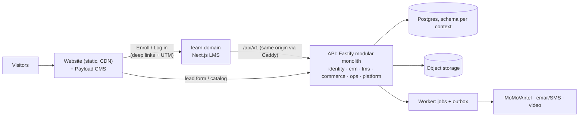

# Z-GATE Platform v2: Website + E-Learning Re-Architecture

**Status:** Proposed, awaiting decisions by the Managing Director (§5).
**Date:** 2026-10-14. **Baseline assessed:** `main` @ `3f5e965`.
**Audience:** Managing Director (decisions), the engineering lead and developers (execution), and future auditors.

> **Revision 1 (2026-10-14):** leadership chose **separate backends per product**, with the **website built first**. See [ADR-007](../architecture/ADR/ADR-007-separate-product-backends.md).
> - The website is full-stack: Next.js with Payload CMS and its own database.
> - The LMS keeps `apps/learn-api`.
> - Before the LMS launches, course buttons on the website open a waitlist.
>
> Where this set describes one shared API (02 §2–§4, 07 §1), ADR-007 takes precedence. Everything else stands. The monorepo now exists (`apps/learn-api`, `apps/ops`, pnpm + Turborepo).
>
> **Revision 2 (2026-10-15):** the repository is now organized by product, with enforced import boundaries (ADR-007, "Amendment"). Paths in this set map as follows: `apps/website` → `website/app`, `apps/learn` → `elearning/frontend`, `apps/learn-api` → `elearning/backend` (package `@zgate/elearning-backend`), `apps/ops` → `legacy/ops`, `packages/*` → `shared/*`.
>
> **Revision 3 (2026-10-15):** the website is now two apps: `website/frontend` (public site, no database) and `website/backend` (Payload CMS, headless), talking over HTTP (ADR-007, "Second amendment"). Where this set says `apps/website` or `website/app`, read: public pages → `website/frontend`; CMS, data and leads → `website/backend`.

---

## 1. The change in direction

v1 was built as **one web application containing the whole business**: marketing site, CRM, client portal, staff operations and the Academy, all together. The new direction is **two separate digital products**:

1. **Website** (`www.{domain}`): brand, divisions, course marketing, lead capture. It **sends learners to** the e-learning platform; it doesn't contain it.
2. **E-Learning platform** (`learn.{domain}`): Z-GATE Academy Online, covering accounts, enrollment, mobile-money payment, lessons, quizzes, live cohorts and verifiable certificates.

Both run on one shared, modular API. The existing client portal and staff console are moved into a third, optional app (`ops`), feature-frozen until the business needs them (decision D2).

## 2. Assessment in brief ([01](01-CURRENT-STATE-ASSESSMENT.md))

**v1 is a well-engineered MVP for a business model that has since changed.** Its security patterns, test discipline and honest documentation are worth keeping. Its product shape is not: the Academy module is a cohort register for in-person training. **Of the 16 capabilities an LMS MVP needs, 3 exist, 3 are partial and 10 are missing.**

Scores out of 5, as **v1 MVP fitness → fitness as a v2 foundation**:

| Criterion | Score | Criterion | Score |
|---|:-:|---|:-:|
| Security | 4 → 3 | Scalability | 3 → **1** |
| Productivity | 3 → 2 | Portability | 3 → 2 |
| Optimization | 4 → 3 | Clean structure | 4 → 3 |
| Performance | 4 → 2 | Usability | 3 → 2 |
| Reliability | **2 → 2** | Future integration | 2 → **1** |
| Accessibility | 3 → 3 | Observability | **1 → 1** |

**Findings no earlier audit recorded.** Four matter most:
- **N-1 (High):** there is no `trustProxy` setting. Behind a production load balancer, *every user shares one rate-limit bucket*: 10 logins per minute for the whole platform.
- **N-2 (High):** the production web image published to GHCR has `localhost` API and site URLs baked into its bundle, sitemap and CSP. It cannot run in any real environment.
- **N-3 (Medium):** a password reset or account deactivation does **not** end existing sessions. An attacker's session survives the reset.
- **N-4 (High for v2):** the schema **forbids individual learners from having accounts**, because every non-staff user must belong to a client company. This is the main structural blocker to e-learning.

The full list (N-1 to N-10) and the still-open findings from the earlier security audit (F-1 to F-5) are in [01 §4](01-CURRENT-STATE-ASSESSMENT.md#4-findings).

## 3. Target design in brief ([02](02-TARGET-ARCHITECTURE.md))

The decisions that matter most:
- **The website has no login and stays up when everything else is down.**
- **Same-origin API through an edge proxy:** no CORS, no baked-in URLs, one image promoted through every environment.
- **Server-side, revocable sessions; roles as scoped memberships; MFA for all staff.**
- **Postgres does more:** a schema per bounded context, a pg-boss job queue and a transactional outbox. No Redis or broker until a measured trigger justifies it.
- **Buy the commodities** (payments, video transcoding/CDN, SMS). **Build the differentiators** (Advisory-linked curricula, low-bandwidth delivery, verifiable certificates, mobile money).
- **Residency:** personal data stays on Rwanda-hosted infrastructure; public content uses a CDN. This is the concrete recommendation for the open ADR-004.

## 4. Document set

| # | Document | Answers |
|---|---|---|
| [01](01-CURRENT-STATE-ASSESSMENT.md) | Current-state assessment | What is there, how good it is, criterion by criterion, with evidence |
| [02](02-TARGET-ARCHITECTURE.md) | Target architecture | Product boundaries, topology, backend contexts, identity, the website → LMS hand-off, technology choices, scale path, residency |
| [03](03-ELEARNING-PLATFORM.md) | E-learning platform | Roles, MVP / V1 / V2 scope, domain model, payments, low-bandwidth design, certificates, AI readiness, NFRs, KPIs |
| [04](04-WEBSITE.md) | Corporate website | IA, CMS model and guardrails, forms and consent, SEO, performance budget, security, accessibility |
| [05](05-SECURITY-COMPLIANCE.md) | Security and compliance | Fate of every open finding, LMS threat model, ASVS L2 controls, audit design, secure pipeline, Law N° 058/2021 gates |
| [06](06-DEVOPS-RELIABILITY.md) | DevOps and reliability | Environments, infrastructure, CI/CD, SLOs, resilience patterns, backup/DR, observability, cost |
| [07](07-MIGRATION-PLAN.md) | Migration plan | Target repo layout, disposition of every v1 part, phased roadmap with effort, decisions, ADRs, risks |

## 5. Decisions needed (detail in [07 §4](07-MIGRATION-PLAN.md#4-decisions-needed-from-the-managing-director))

| ID | Decision | Recommendation |
|---|---|---|
| D1 | Build or adopt the LMS | Build a focused LMS; Moodle as an explicit stopgap |
| D2 | Future of the ops portal | Keep, moved and frozen; revisit when the first Advisory client needs it |
| D3 | Hosting / residency (ADR-004) | Hybrid: personal data in Rwanda, public content on a CDN; counsel to confirm |
| D4 | Production domain | Decide now |
| D5 | Payment aggregator | Shortlist and start KYC now |
| D6–D9 | Retake policy, minimum age, language order, self-paced pricing | Business decisions; defaults proposed |
| D10 | Team | Contract a senior full-stack lead alongside the junior developer |
| D11 | AI scope | Approve captions/transcripts pilot only |
| — | NCSA registration, DPO | Start now; these are **hard launch gates** for the LMS |

## 6. Roadmap at a glance (detail in [07 §3](07-MIGRATION-PLAN.md#3-phased-roadmap))

| Phase | Outcome | Effort (pw, ±40%) |
|---|---|---|
| 0. Stabilize and decide | v1 blockers fixed; monorepo skeleton; decisions; payment and compliance applications started | 2–3 |
| 1. Platform foundations | Identity v2, audit, jobs/outbox, storage, OpenAPI, **staging with monitoring and backups** | 6–8 |
| 2. Website v2 *(parallel)* | **Website live**, with CMS, privacy, consent and attribution | 3–5 |
| 3. LMS MVP | **First paid online cohort** of Course 1 | 14–20 |
| 4. LMS V1 | B2B seats, Kinyarwanda UI, offline PWA, WhatsApp | 10–16 |

With **one senior and one junior developer**, the website goes live in about 6–8 weeks and the first paid online cohort follows in about 3–4 months. The biggest schedule risk is **not code**. It is **course content production** and **payment-provider onboarding**; both have to start in Phase 0.

## 7. Next 30 days

1. MD reviews this set and decides D1–D5 and D10.
2. Fix N-1, N-2 (interim), F-1, F-2, F-6 and F-7 in the current codebase (about 1 pw). These defects carry over into any future version.
3. Apply to the shortlisted payment aggregator(s), and begin NCSA registration and DPO designation.
4. Create the monorepo skeleton and move v1 into it with all 97 backend tests green.
5. Academy Trainer starts scripting and recording Course 1 lessons, with captions.
